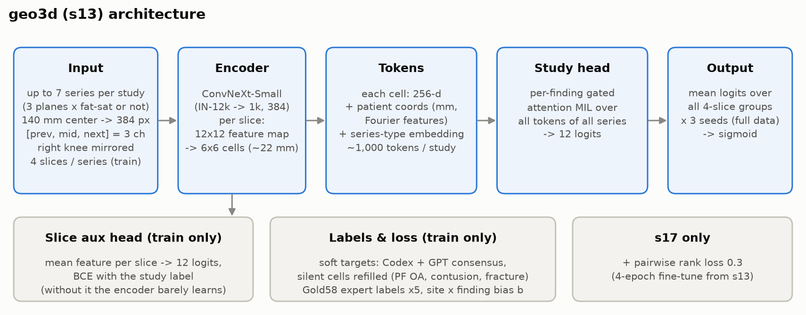
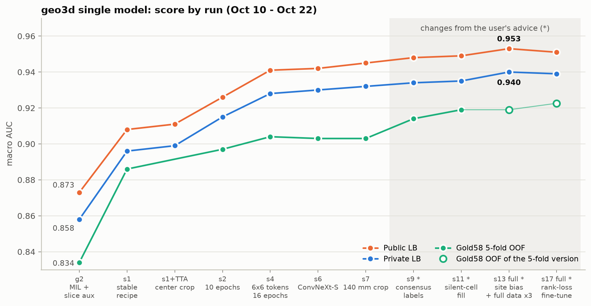
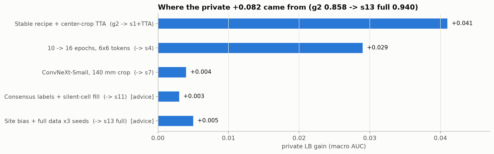
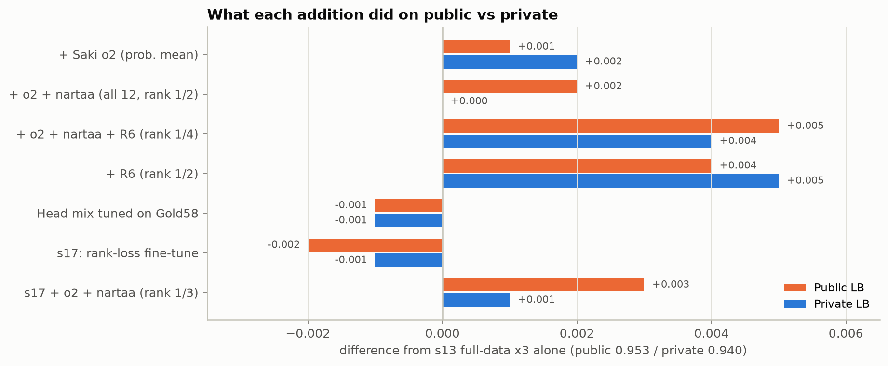
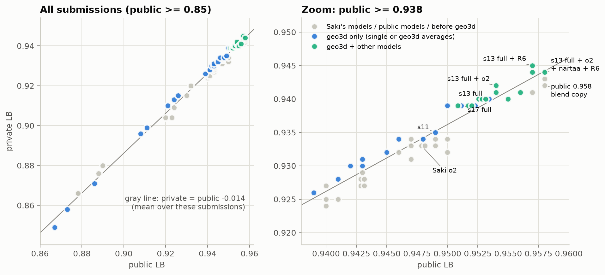
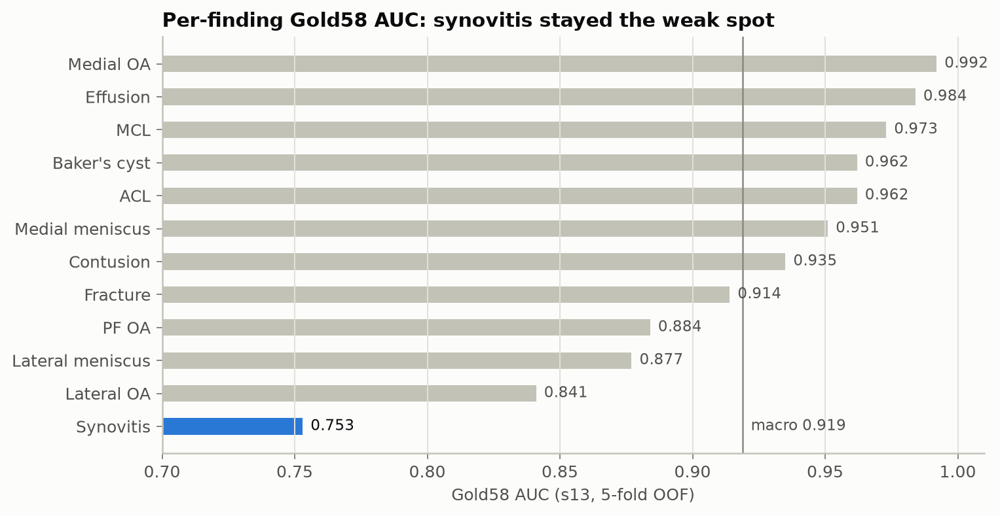

# RSNA Knee Abnormality Detection まとめ（2026-09-30〜10-22）

自前モデル geo3d をどう作っていったか、ユーザーの助言から何を足して、スコアがどう動いたかのまとめ。
数字は Gold58 の 5 fold OOF（macro AUC）、public LB、private LB の 3 つ。private は締切後の 2026-10-24 に Kaggle API の提出一覧で取った（`/mnt/home/ishikawa/kaggle/logs/subs_after_deadline_20261024_all.csv`）。
日々の細かい記録は、プロジェクト側の `../GEO3D_EXPERIMENT.md`（geo3d の実験ノート）、`../RUN_NOTES.md`（10/09 より前）、`../GEO3D_PROGRESS_REPORT.md`（崎さんへの報告）にある。
図は `figures/` にあり、`python scripts/make_summary_figures.py` で作り直せる。このサーバに日本語のフォントが無いので、図の中の文字は英語にした。

## 1. 結果

| | 提出 | public | private |
|---|---|---|---|
| **チームの private 最高**: s13 全データ × 3 + R6（公開）を順位で半々 | 57476015 | 0.957 | **0.945** |
| s13 全データ × 3 + 崎さんの o2 + nartaa + R6 を順位で 1/4 ずつ | 57473665 | **0.958** | 0.944 |
| s13 全データ × 3 + 崎さんの o2（確率の等重み） | 57366376 | 0.954 | 0.942 |
| **自前の単体の最高**: s13 全データ × 3 seed | 57368467 | 0.953 | **0.940** |
| s17 全データ × 3 seed（s13 + 順位損失の追加学習） | 57526262 | 0.951 | 0.939 |
| 参考: 崎さんの o2（5 fold × 2 seed、SWA 10 本） | 57062299 | 0.948 | 0.933 |
| 参考: 公開 notebook の 0.958 の混ぜ方をそのまま | 57318672 | 0.958 | 0.942 |
| 参考: 10/08 までの最高（公開 CoAtNet などの順位平均） | 56962340 | 0.950 | 0.934 |

- 自前の geo3d は、単体で private 0.940。崎さんの o2 単体（0.933〜0.934）や、公開モデルを集めた 10/08 の 0.950（private 0.934）より上だった。public では o2 と 0.004〜0.005 差だったが、private では 0.006〜0.007 差に広がった。
- 最終に選んだ 2 本は `57473665`（s13 全データ × 3 + o2 + nartaa + R6 の順位 1/4、public 0.958 / private 0.944）と `57531043`（s17 全データ × 3 + o2 + nartaa の順位 1/3、public 0.956 / private 0.941）。前者で 228 位 / 6,300 チーム（銀メダル）。選んでいない提出の private 最高は geo3d + R6 の 0.945。

## 2. コンペの概要

- 膝 MRI から 12 所見（ACL、MCL、内側・外側半月板、内側・外側・PF の OA、関節液、滑膜炎、Baker 嚢腫、骨挫傷、骨折）のマルチラベル分類。評価は 12 所見の macro ROC AUC。
- 学習は 4,407 検査（24,371 シリーズ、819,076 スライス）。専門家のラベルが付いているのは **Gold58（58 件）だけ**で、残り 4,349 件には所見文（Report、多言語）しかない。所見文から擬似ラベルを作って学習する。
- テストは隠しデータ（約 1,300 件と推定）。コード提出で、Kaggle の T4 で 9 時間以内。締切は 2026-10-22 23:59 UTC。
- 事前に考えた難しさ:
  - 擬似ラベルの質。とくに所見文に書かれない所見（滑膜炎は 84% が記載なし）。
  - Gold58 が 58 件しかないので、ローカルの物差しが粗い（見分けられる差は ±0.014 程度）。
  - public は全体の約 30% で揺れが大きい。

## 3. 全体の流れ

| 時期 | やったこと | 到達点（public / private） |
|---|---|---|
| 9/30〜10/08（Windows） | 公開 notebook（D4 アンサンブル、DINOsaur の ConvNeXt）を土台に、擬似ラベルの見直しと自前の部品の追加。OrthoFoundation（膝の基盤モデル）の自前モデル、MARS（3D の基盤モデル、凍結特徴）も試した。ユーザーの指示で、全 4,407 件の所見文を Codex で読んでラベルを作った（後の geo3d のラベルの土台）。 | D4 0.943 / 0.927、OrthoFoundation 単体 0.878 → 0.890 / 0.866 → 0.880、公開 CoAtNet 系の再現 0.950 / 0.932〜0.934 |
| 10/09 | 研究室サーバへ移行。256KB を超えるファイルの多くが途中で切れていた（6,124 件）。PNG キャッシュを配布 zip から取り直し。**方針の転換（ユーザー）: 公開モデルの流用をやめ、自前のモデルを一から作る。崎さんのモデルも真似しない。** | — |
| 10/09〜10/15 | geo3d を一から作り、単体で伸ばした（g2 → s11）。 | 0.873 → 0.949 / 0.858 → 0.935 |
| 10/15〜10/19 | 崎さんとチームを組み、o2 と混ぜた。施設のずれの吸収（s13）、全データ学習 × 3 seed。 | s13 全データ: 0.953 / 0.940、+ o2: 0.954 / 0.942 |
| 10/19〜10/22 | ユーザーの判断で公開モデル（nartaa の CoAtNet、heliosli の R6）とも混ぜた。順位損失の追加学習（s17）。 | 0.958 / 0.944、s13 + R6 0.957 / **0.945** |

## 4. geo3d の構成（最終の s13）

上の段が推論の流れ。下の段（灰色）は学習のときだけ使う部品。

- **入力**: 1 検査から最大 7 シリーズ（断面 3 × 脂肪抑制の有無の 6 種類から 1 本ずつ → 残りは枚数の多い順）。原画の中央 140mm を 384px に切り出し、[前, 中, 後] の 3 枚を 3 チャンネルに。右膝は左右反転して左膝にそろえる。
- **エンコーダ**: ConvNeXt-Small（ImageNet-12k → 1k、384）。1 枚 12×12 の特徴を 6×6 = 36 マス（1 マス約 22mm）に。
- **トークン**: 各マスに、DICOM から計算した患者座標（mm）の Fourier 特徴とシリーズの種類の埋め込みを足す。1 検査で約 1,000 トークン。
- **頭**: 所見ごとのゲート付き注意 MIL（全シリーズの全マスから、所見ごとに場所を選んでまとめる）。学習中だけ、スライスごとの補助ヘッドにも検査のラベルで損失をかける。
- **ラベル**: 所見文ラベルの合意（Codex と GPT 系 3 種）。記載なしの欄の一部（PF OA・挫傷・骨折）は OOF で埋め直す。Gold58 は専門家のラベルを重み 5 で使う。施設（所見文の書式のクラスタ 24 個）× 所見のずれを学習中に吸収する。
- **学習**: 1 シリーズ 4 枚、バッチ 4 検査 × 累積 2、エンコーダの学習率 5e-5、スライス単体の予備学習 300 ステップ、16 エポック固定、EMA 0.998。RTX 3090 で 1 本約 3.3 時間。
- **推論**: 4 枚の組を全部作って平均。中央 93% の切り出し。全データ × 3 seed のロジットの平均。T4 で隠しテスト約 2 時間。

崎さんの o2 との違い（混ぜたときに上積みが出るよう、寄せないようにした）:

| | geo3d | 崎さん o2 |
|---|---|---|
| エンコーダ | ConvNeXt-Small | CoAtNet-2 |
| トークン | 1 枚を 6×6 マス + 患者座標 + シリーズの種類 | 1 枚 1 ベクトル |
| まとめ方 | 全シリーズの全マスから所見ごとの注意 MIL | 枠ごとの所見別注意（Raptor 型） |
| ラベル | Codex + GPT 系の合意（確率の soft target、BCE） | Claude が読んだ段階ラベル（CORAL + 順位損失） |
| OOF の相関 | — | Spearman 0.80、ひどい外し方の重なり 0.47（自前どうしは 0.89 / 0.59） |

## 5. 自前モデル単体のスコアの推移

- 横軸は run の順（10/10〜10/22）。灰色の帯（* 印）がユーザーの助言から入れた変更。
- s13 と s17 は全データ版（Gold58 で測れない）なので、Gold58 は同じ設定の 5 fold 版の値（白抜きの点）。
- 3 つの物差しは同じ向きに動いている。前半の大きな伸びは学習の回し方、後半の小さな伸びはラベルとデータの使い方から来ている。

きっかけの欄: 「助言」= ユーザーの助言・指示から、「自分」= こちらの判断。

| run | 何を変えたか | きっかけ | Gold58 OOF | public | private |
|---|---|---|---|---|---|
| p0 | Transformer デコーダ、取得途中のデータ（推論経路の確認） | 自分 | — | 0.674 | 0.621 |
| g2 | 所見別の注意 MIL + 3×3 トークン + 患者座標 + **スライス補助損失**（無いとエンコーダがほぼ学習しない） | 自分 | 0.834 | 0.873 | 0.858 |
| s1 | **学習の安定化**（1 シリーズ 4 枚・8 検査 / 更新・lr 5e-5・予備学習 300 ステップ） | 自分 | 0.886 | 0.908 | 0.896 |
| s1 + TTA | 推論で中央 0.87 を切り出す | 自分 | — | 0.911 | 0.899 |
| s2 | 6 → 10 エポック | 自分 | 0.897 | 0.926 | 0.915 |
| s3 | 記載なしの欄の重み 0.3（採らず） | 自分 | 0.896 | 0.921 | 0.910 |
| s4 | **6×6 トークン + 16 エポック** | 自分 | 0.904 | 0.941 | 0.928 |
| s6 | ConvNeXt-Tiny → Small | 自分（重みの取得はユーザーが許可） | 0.903 | 0.942 | 0.930 |
| s7 | Small + **原画から 140mm を切り出したキャッシュ** | 外部レビューの指摘（約 60GB の取得をユーザーが許可） | 0.903 | 0.945 | 0.932 |
| s8 | s4 + **複数の所見文ラベルの合意**（目標と重み） | **助言**（10/13） | 0.912 | 0.943 | 0.931 |
| s9 | s7 + 合意ラベル | 助言 | 0.914 | 0.948 | 0.934 |
| s11 | s9 + PF OA・挫傷・骨折の**記載なしの欄の埋め直し** | **助言**（10/15「ガチガチに固めてから実行」） | 0.919 | 0.949 | 0.935 |
| s13（5 fold） | s11 + **施設ごとの所見文の基準のずれを吸収** | **助言**（10/17） | 0.919 | （単体は未提出） | — |
| **s13 全データ × 3** | 検証なしで全 4,407 件 × seed 0〜2 | **助言**（10/17「提出するものは全件で学習（5/4 倍）」） | — | **0.953** | **0.940** |
| s13 全データ・ヘッドの比を調整 | 所見ごとに検査 / スライスヘッドの比を Gold58 で選ぶ | 助言（10/21「ローカル CV が一番高くなるように」） | （選んだので甘い）0.927 | 0.952 | 0.939 |
| s17 全データ × 3 | s13 から**順位損失**を足して 4 エポック追加 | **助言**（10/22、崎さんとの話から） | 0.9226（5 fold 版） | 0.951 | 0.939 |

- 自前どうしの平均: s2 + s3 0.924 / 0.913、s4 + s2 0.939 / 0.926、s4 + s6 0.943 / 0.930、s7 + s8 0.946 / 0.934。弱いほうを混ぜると単体の最高より下がった（2 回）。強さのそろった 2 本でも +0.001 程度。
- private の伸び（g2 → s13 全データ、+0.082）の内訳: 学習の安定化と推論の切り出しで +0.041、エポックとトークンで +0.029、エンコーダと切り出しで +0.004、ラベル（合意 + 埋め直し）で +0.003、施設のずれと全データ学習で +0.005。**大きく効いたのは学習を正しく回すこと（安定化・エポック・解像度）で、ラベルの工夫は 1 回あたり +0.001〜0.003**。

[advice] の付いた 2 つがユーザーの助言から入れたもの。伸び幅は小さいが、自前モデルの伸びが頭打ちになった後半（s7 の private 0.932 → s13 全データの 0.940）の上積みは、すべてこの 2 つから来ている。

- 5 fold で一度に試さず、fold 0 の「明らかなラベル」（Codex と GPT が一致した欄、4,349 件）で先に比べ、+0.005 以上のものだけ 5 fold に回した。

## 6. 助言から入れた工夫と、その結果

### 6.1 効いたもの（採用）

| 日付 | 助言 | やったこと | 結果 |
|---|---|---|---|
| 10/01 | 公開の擬似ラベルに頼りすぎず、LLM で所見文を直接読む（Codex の利用枠で） | Codex が全 4,407 件の所見文を読んで 12 所見の確率を付けた（`codex_report_labels`） | geo3d の最初のラベル。所見文ラベル自体の Gold58 AUC 0.888 で、公開のラベル（0.886〜0.893）と同じ水準。後の合意ラベルの片側になった |
| 10/09 | 公開モデルの流用をやめ、一から作る。崎さんのモデルも真似しない（「notebook をコピペして 0.95 付近で埋もれるのと同じ」） | geo3d をゼロから設計。崎さんの構成（CoAtNet-2 + Raptor + CORAL）とは別の作りにした | 単体で private 0.940（o2 は 0.933）。o2 と混ぜて +0.002、R6 と混ぜて +0.005 の上積みが出た。作りが違うことが、合流後の上積みの元になった |
| 10/09 | fold を崎さんの `labels_fused.csv` に合わせ、Gold58 の 5 fold OOF で評価する | 崎さんの数字（r1 0.899 → LB 0.930、o4 0.922 → 0.946）と直接比べられる物差しにした | OOF → public の関係（+0.024〜0.032）がこちらの run でも同じに出た。合流後、o2 の OOF をこちらで作ったときもそのまま突き合わせられた |
| 10/09 | Gold58 には過学習させてよい（学習で重みを上げて使う） | Gold58 を重み 5 で学習（検証 fold の Gold は外す） | 以後ずっと使った |
| 10/12 | 10/15 のチーム結成までは単体を上げ、結成後にアンサンブル | 単体の強さに加えて、崎さんの OOF と混ぜたときの上積み Δens も毎回測った | Δens は単体が強くなっても減らなかった（s2 +0.006 → s11 +0.013） |
| 10/13 | public に過学習させない。頑健さを担保しつつ public でもそれなりに | public の揺れを OOF の部分抽出で見積もった（2 モデルの差の標準偏差 0.003〜0.005）。採否は OOF で決め、混ぜ方は等重みを事前に固定 | private で見ても、public と private の順位はほぼそろっていた（§8） |
| 10/13 | 前処理とラベルの付け方を詰める。複数の方法のラベルを使い、ばらつきで重みを変える | **s8 / s9**: 記載ありの欄の目標 = 0.5 × Codex + 0.5 × GPT 系 3 種の平均、食い違う欄は重みを 0.5 まで下げる | Gold58: s4 0.904 → s8 0.912、s7 0.903 → s9 0.914（+0.011 [−0.002, +0.026]）。public 0.945 → 0.948、private 0.932 → 0.934。食い違う欄（Codex だけ陰性）は Gold58 で陽性率 0.44 で、目標 0.5 は結果として合っていた |
| 10/15 | 「ガチガチに固めてから実行」 | 滑膜炎の案（s9syn）をラベルの段階で確かめたら悪化すると分かり中止。記載なしでも陽性が多い所見を調べ直し、**s11**: PF OA・挫傷は 0.5 × ラベル + 0.5 × OOF、骨折は挫傷からも埋める | Gold58 0.914 → 0.919（埋めていない 9 所見は差なし）、public 0.949、private 0.935。v3 との Δens は最大の +0.013 |
| 10/15 | 精度を落とさない（推論の時間を k12 で削らない） | o2 の 10 本を 2 枚の GPU に分けて並べて動かし、9 時間に収めた | s9 + o2 が時間切れ（`57215044`）から完走へ |
| 10/17 | 施設によって基準が違うので合わせる | **s13**: 所見文の書式で 24 施設に分け、施設 × 所見のずれ b を学習中に吸収（推論では使わない） | 単体の Gold58 は s11 と同じ（0.9190 / 0.9194）。o2 と混ぜると 0.9274（s11 + o2 は 0.9265）、public 0.953 / private 0.940（s11 + o2 は 0.952 / 0.939）。学習されたずれは小さく（標準偏差 0.09〜0.15）、効果は揺れの範囲 |
| 10/17 | CV はローカルの評価用。提出するものは全件で学習したほうがいい（5/4 倍）→「時間かかりすぎる？」→ 最後の private 用だけ全件で | s13 を全データ × 3 seed（約 10 時間）。16 エポック固定・最後の EMA なので、全データにしても選び直すものが無い | 単体 public 0.953 / private 0.940（5 fold の s11 単体は 0.949 / 0.935）。o2 と混ぜると、5 fold 版 0.953 / 0.940 → 全データ版 0.954 / **0.942**（private +0.002） |
| 10/19〜21 | nartaa の公開 CoAtNet（OAI で学習）、heliosli の公開 R6 と混ぜる（規則の不確かさは承知のうえ） | 滑膜炎だけ → 12 所見すべて → geo3d・o2・nartaa・R6 を順位で 1/4 → geo3d と R6 だけ半々 | 4 つ: 0.958 / 0.944。**geo3d + R6: 0.957 / 0.945（チームの private 最高）**。崎さんの S5（geo3d なし）は 0.958 / 0.943 で、geo3d を足すと private が上がった |

### 6.2 効かなかったもの・採らなかったもの

| 日付 | 助言 | やったこと | 結果 |
|---|---|---|---|
| 10/12 | 当たるときは 0/1、外れそうなら 0.5 に近く出したい（キャリブレーション・不確実性） | OOF で確かめた。所見ごとの単調な変換では AUC は変わらない。不一致で 0.5 へ縮める案も試した | 縮めると下がった（Gold58 0.904 → 0.881 など）。性質の違うモデルの確率平均が、すでに「不確実なら真ん中」の働きをしている。入れなかった |
| 10/14 | キャリブレーションをそろえ、確信度の低い予測を確信度の高いモデルで補う | 校正してから確信度で重み付け、確信度の高いほうだけ、などを s7 + v3 で比べた | 強く頼るほど下がった。ロジットの平均が確信度の高いほうに自然に寄るので、それで足りている |
| 10/14 | 出典が多く一致する欄ほど強く学習。食い違いはエントロピーで測る | **s10**: 重みを 3 系統（Codex・GPT 系・Claude）の JSD で付け直した | 2 fold で s8 とほぼ同じ（Gold58 は fold 0（8 件）で s10 0.947 / s8 0.961、fold 1（18 件）で 0.933 / 0.931）。記載なしの対策を優先して止めた。一致は「所見文の読み方が割れていない」ことしか表さず、3 系統とも陽性でも Gold58 では 84% |
| 10/15 | 得意な所見が違うので、所見ごとに混ぜる比を変えたい | o2 の重みを所見ごとに選び、選ぶ検査と測る検査を分けて比べた | Gold58 全体で選ぶと +0.0095 だが、入れ子の CV では −0.0006。Gold 以外で選んでも +0.0007。所見別（s9 + o2）は 0.951 / 0.939、等重み（s11 + o2）は 0.952 / 0.939 |
| 10/16 | 滑膜炎は、記載なしでも陽性になりうる周辺の要因をすべて考慮して専門的に判断する | 文献に基づく基準（`../SYNOVITIS_LABEL_RUBRIC.md`）を作り、Claude Opus のサブエージェント 20 本が全 4,407 件を読んで判定 | 読みは正確（記載のある欄で GPT と AUC 0.985）だが、Gold58 の記載なし 42 欄では 0.652（Codex 0.765）。所見文だけでは記載なしの滑膜炎は並べられない。使わなかった |
| 10/17 | 曖昧な部分は Gold58 で調整し、その規則を Gold 以外に当てる | 判定の手がかり 6 つのロジスティック回帰を Gold58 の記載なしの欄で学習し、fold を分けて評価 | 0.630（Codex 0.765）。使わなかった |
| 10/17 | 記載ありの陽性と記載なしの陽性は何が違うのか | Gold58 で比べると、記載なしの陽性の 10/14 は外傷（挫傷・骨折）の検査（記載ありは 3/13、p = 0.02）。外傷の所見文には滑膜炎が書かれにくい。**s14**: 外傷 + 関節液の記載なしの滑膜炎（760 欄）を陰性として学習しない | Gold58 の滑膜炎 0.765 → 0.789 だが、全体 0.919 → 0.916、記載ありの欄の並びが 0.947 → 0.926。採らなかった |
| 10/19 | 3 枚では病変が入らないことがある。範囲が症例で違う | 学習と同じ「4 枚の組 1 つだけ」の推論と、全組の平均を比べた | 小さな病変の 5 所見で −0.012（事前の基準 −0.02 に届かない）。1 回分でも全スライスの 9 割ほどの情報は取れている。枚数を増やす s15 は回さなかった |
| 10/19 | 滑膜炎に使える外部データはあるか | 調べただけ | 画像に滑膜炎のラベルがある公開データは見つからなかった（OAI の MOAKS は申請制） |
| 10/19 | 1 を一本出してみる（nartaa を 12 所見すべてへ） | 全データ版 s13 + o2 と順位で半々 | public 0.954 → 0.955（+0.001）だが、**private 0.942 → 0.940（−0.002）**。滑膜炎だけ混ぜたもの（0.954 / 0.941）は土台の 0.953 / 0.940 より両方で +0.001 |
| 10/20 | （こちらの提案を了承）補助損失をエポック 5〜16 で 1.0 → 0.2 に下げる | **s16** の 5 fold | Gold58 0.913（s13 0.919）。採らなかった |
| 10/21 | 滑膜炎の Gold をほかの 11 所見から予測できるか / 単純なロジスティック回帰で | Gold58 の中の CV | 専門家のラベル 11 所見からでも 0.67〜0.72 止まり。滑膜炎の多くはほかの所見では説明できない |
| 10/21 | 一番ローカル CV が高くなるようにチューニングして提出 | 所見ごとに検査 / スライスヘッドの比を Gold58 で選んだ | Gold58 0.919 → 0.927 だが入れ子の CV では +0.002。public 0.952 / private 0.939（調整なしは 0.953 / 0.940）。はっきり効いていたのは滑膜炎（スライスヘッドだと 0.753 → 0.827）だけ |
| 10/22 | R6 は public に過学習していて危険。今の損失に pairwise ranking loss を足す（崎さんとの話から） | **s17**: s13 の重みから順位損失 0.3 で 4 エポック追加。締切に間に合わせるため 5 fold と全データを並べて回し、対照（順位損失なし）は途中で止めた | Gold58 0.919 → 0.923（+0.004 [−0.003, +0.010]、外側 OA 0.841 → 0.882 など）。全データ版は public 0.951 / private 0.939 で、s13 を上回らなかった。o2 + nartaa と 1/3 ずつは 0.956 / 0.941 |

### 6.3 運用についての助言

- **検証が済んだら許可なしで提出**（10/10）: notebook が完走し、見える test 3 件で手元の推論と一致（差 1e-4 未満）したら、すぐ出す。1 日 5 回の枠を使って LB を早く見られた。
- **public の揺れの見積もり**（10/13）: 隠しテスト約 1,300 件・public 30% と仮定して OOF を部分抽出すると、1 モデルの public の標準偏差は約 0.010、2 モデルの差は 0.003〜0.005。本当の差が 0 の 2 本なら、public と private で優劣が逆になる割合は 57%。以後、public の差が 0.005 未満なら判断に使わないことにした。
- **結果を見る前に採否の条件を書いておく**: 新しい run を始める前に、何を比べ、どうなったら採るかを `GEO3D_EXPERIMENT.md` に書いてから回した（s11、s12、s13、s14、s17 など）。Gold58 を見て決めた条件は、その所見の Gold58 が甘く出ることも明記した。
- **最終の全データ学習は早めに**（10/18）: 最終日に初めて動かすと、壊れていたときに直す時間がない。s14 を採らなかった時点で GPU が空いたので、s13 の全データ版を 10/18 に回した。

## 7. 合流後のアンサンブル

| 混ぜ方 | 提出 | Gold58 OOF | public | private |
|---|---|---|---|---|
| s9 + o2（所見別の重み） | 57231572 | 0.9245 | 0.951 | 0.939 |
| s11 + o2（等重み） | 57232019 | 0.9274 | 0.952 | 0.939 |
| s11 + o2（o2 を 320 の中央切り出しに） | 57296480 | 0.9265 | 0.952 | 0.939 |
| s13（5 fold）+ o2 | 57323180 | 0.9274 | 0.953 | 0.940 |
| s13（5 fold）+ o2、滑膜炎だけ nartaa と順位で半々 | 57366315 | — | 0.954 | 0.941 |
| s13 全データ + o2 | 57366376 | — | 0.954 | 0.942 |
| s13 全データ + o2、12 所見すべて nartaa と順位で半々 | 57381683 | — | 0.955 | 0.940 |
| s13 全データ + o2 + nartaa + R6（順位で 1/4） | 57473665 | — | 0.958 | 0.944 |
| s13 全データ + R6（順位で 1/2） | 57476015 | — | 0.957 | **0.945** |
| s17 全データ + o2 + nartaa（順位で 1/3） | 57531043 | — | 0.956 | 0.941 |

- s13 全データ単体（public 0.953 / private 0.940）からの差。スコアは小数 3 桁に丸められているので、±0.001 は差が無いのと同じ。
- R6 を足したもの（下から 4 本目と 5 本目）だけが、public でも private でも +0.004〜0.005 伸びた。nartaa を 12 所見すべてに混ぜたものは public だけ +0.002 で、private は 0。Gold58 で選んだもの（ヘッドの比）と s17 は、どちらでも伸びなかった。
- 混ぜ方は確率の等重み平均に固定した（OOF で比べると順位平均がいちばん悪かった。確信度の強弱を捨てるため）。公開モデルは OOF が無いので、順位で等分。
- o2 との組み合わせは、事前に決めた条件（Gold58 で両方の単体以上、明らかなラベルで差の区間が 0 より上）を満たしたものだけ出した。
- 公開モデル（nartaa、R6）は OAI など申請制のデータや、非公開の臨床画像で事前学習した重みに頼る。大会の規則（「公開・無料で使える物は可」）に合うかは、はっきりしないまま使った。

## 8. public と private

- 左が全提出、右が public 0.938 以上の拡大。灰色の線は「private = public − 0.014」（全提出の平均の差）。チームの提出（崎さんの分も含む）をすべて入れた。
- 小数 3 桁で同じ点になる提出は、重ならないよう横に少し（丸めの幅より小さく）ずらした。
- geo3d を含む提出（青・緑）は、34 本のうち 76% が灰色の線より上に来た（ほかの提出は 31 本のうち 23%）。private − public の平均は geo3d を含むもので −0.013、ほかで −0.015。public で見たより、private ではわずかに強かった。

- 提出 65 本（public 0.85 以上）で、**private は public より平均 0.014 低く（−0.010〜−0.019）、順位の相関は Spearman 0.988**。public 0.950 以上の 22 本の中でも 0.939。大きな入れ替わりは無かった。
- 差が 0.003 以下のものは入れ替わった。public 0.958 の 3 本（4 つの混ぜ方、崎さんの S5、公開の混ぜ方のコピー）は private 0.944 / 0.943 / 0.942 で、public 0.957 の s13 + R6 が 0.945 で上に来た。事前の見積もり（差 0 なら 57% で逆転）のとおり。
- 振り返り:
  - **R6**: ユーザーは「public に過学習していて危険」と見ていたが、private でも効いていた。s13 全データ 0.940 → + R6 0.945（+0.005、public は +0.004）。
  - **nartaa を 12 所見すべてに**: public は +0.001 だったが、private は −0.002。public だけ見ていたら採っていた。
  - **全データ学習**: 5 fold 版 → 全データ版で private +0.002（s13 + o2）。
  - **Gold58 で選んだもの**（所見ごとの重み、ヘッドの比）: public でも private でも上がらなかった。入れ子の CV の見積もり（+0.000〜0.002）のほうが正しかった。
  - **順位損失（s17）**: Gold58 で +0.004 でも private は −0.001。Gold58 の ±0.014 の幅の中だった。
  - **自前の geo3d の強み**: public では o2 と +0.004〜0.005 差、private では +0.006〜0.007 差。public の公開モデルのコピー（0.958）も private では 0.942 で、geo3d + o2（0.942）と同じ。

## 9. 知見（次に持ち越すこと）

### モデルと学習
- **ラベルの工夫より、学習を正しく回すことのほうが効く。** 学習の安定化（1 回の更新の検査数を増やし、エンコーダの学習率を下げ、予備学習を入れる）だけで private +0.038。エポック数とトークンの細かさでさらに +0.029。ラベルの工夫は 1 回あたり +0.001〜0.003。
- **アブレーションの前に、同じ設定の実行ごとの揺れを測る。** 不安定な設定で測った「患者座標で +0.034」は、安定化した後に測り直すと 0 だった（右膝を反転して左膝にそろえているので、内側・外側は画像だけで分かる）。同じ設定を 2 回回して揺れ（0.003〜0.008）を先に知る。
- **袋（検査）単位の損失だけでは、エンコーダが学習しない。** スライスごとの補助損失が必須だった（Gold58 で検査ヘッド 0.886 に対し、スライスヘッドだけなら 0.828。補助損失なしではほぼ立ち上がらない）。効いているのは「スライスの中の場所を選ぶ注意」。
- 断面をまたぐ自己注意、24 エポック、記載なしの欄の重み下げ、補助損失の減衰は効かなかった。
- 断面の使い分けは学習に任せても解剖学どおりになった（ACL・半月板は矢状断、MCL は冠状断と軸位断、Baker・関節液は軸位断）。どの断面も 1 つ抜いて −0.01 前後で、ほかの断面で補えている。

### ラベル（所見文からの擬似ラベル）
- 所見文ラベルの出典どうしの食い違いは、雑音というより**陽性の線引きの違い**（軽い変性・少量の関節液・捻挫を陽性に数えるか）。両方の定義の平均を目標にし、食い違う欄の重みを下げると効く。
- 出典を増やしても独立な意見は増えない（GPT 系どうし・Claude は 95% 一致で、実質「厳しめの Codex」と「緩めのそれ以外」の 2 つ）。一致は所見文の読み方が割れていないことしか表さず、所見文そのものの見落としは分からない。
- **「記載なし」の意味は所見で決まる。** 滑膜炎・PF OA・骨折・挫傷は記載なしでも陽性が 18〜33%。埋め直しは所見ごとに、ラベルの段階で Gold58 との AUC を確かめてから学習する（s9syn はここで悪化と分かり、学習の前に止められた）。
- **滑膜炎は最後まで弱かった**（Gold58 0.75 前後、ほかは 0.84〜0.99）。所見文ラベルの列そのものは 0.81 あるのに、モデルが学べていない。記載なしの陽性は外傷の検査に多く、書き手の側の癖（外傷のときは滑膜炎を書かない）が原因とみられる。所見文をどう読み直しても、記載なしの滑膜炎は並べられなかった。画像に滑膜炎のラベルがある外部データも無く、公開モデル（OAI で学習した nartaa）と混ぜるのが唯一 public で +0.001 だった。

s13 の 5 fold OOF の、所見ごとの Gold58 AUC。滑膜炎だけが 0.75 と離れて低い。滑膜炎の Gold58 の陽性は 27 / 58 件で少なくはないので、件数のせいではない（陽性の半分が所見文に記載なし）。

### 評価とアンサンブル
- **Gold58 は 58 件なので ±0.014 より小さい差は見分けられない。** 細かい比較は「明らかなラベル」（4,349 件、±0.002）で行う。ただしラベルの定義を変えた run どうしでは使えない（Codex と GPT の一致で作るので、合意ラベルに有利）。
- Gold58 で重みや比を選ぶと、その分だけ Gold58 が甘くなる。選ぶ検査と測る検査を分けた入れ子の CV で見ると、ほとんどが消えた。public と private でも上がらなかった。
- 自前どうしの平均は、似ている（相関 0.89）ので上積みが小さく、弱いほうを混ぜると下がる。**作りの違う独立なモデル**（o2、R6）を混ぜたときだけ +0.002〜0.005 伸びた。チームの中で、本質的に違うモデルを持っておく価値が大きかった。
- 確率の平均がすでに「2 本が食い違えば真ん中に寄る」働きをするので、不確実性で縮める後処理を重ねると二重に効いて下がる。

### 運用・インフラ
- サーバ移行の後に、ファイルが壊れていないかを大きさとハッシュで確かめる（256KB の倍数で切れていた）。
- NFS 上の PNG は 1 枚開くのに約 50ms。ワーカーの中でスレッド 16 本で並列に読むと 1 検査 5.5 秒 → 0.4 秒。
- cuDNN は入力の形が変わるたびに実行計画を作り直す（1 回 12〜30 秒）。枚数を 16 の倍数に詰め物して形の種類を減らす。
- Kaggle の notebook: データセットの版の指定が効かない（最新版が付く）、Kaggle Model は 1 つしか付かない、既存の instance に足したばかりの版が外れることがある。提出のたびに新しい instance を作り、push の後に入力を読み直して照合した。
- 推論時間の見積もりを誤って 9 時間の時間切れを 1 回出した（`57215044`）。隠しテストの件数で見積もり、2 枚の GPU に分ける、時間で打ち切る安全装置を付ける、で直した。
- 締切の前日は、学習（約 10 時間）と採点（約 6 時間）を逆算して、全データ学習を早めに始める。

## 10. このフォルダに入れたもの

詳しくは [`README.md`](README.md)。

- 重み: s13 と s17 の、5 fold 版（CV、`outputs/geo3d/s13/`、`outputs/geo3d/s17rank/`）と全データ版 × 3 seed（`outputs/geo3d/s13full_s*/`、`outputs/geo3d/s17full_s*/`）。16 本、sha256 は `WEIGHTS_SHA256.txt`。
- 学習: `src/geo3d/`、`scripts/train_geo3d.py`、`run_train_5fold.sh`、`run_train_full.sh`、`run_train_s17.sh`、ラベル・施設・fold の CSV。
- 提出: `kaggle_submitted/<instance>/`（s13 単体・+ o2・+ R6・4 つ、s17 単体・3 つ の 6 本の notebook）、`run_submit.sh`、`scripts/geo3d_submit.py`。
- 図: `figures/`（作り直しは `scripts/make_summary_figures.py`。散布図の元の提出一覧は `figures/data/submissions_20261024.csv`）。
- 画像データ（PNG キャッシュ）、大会の CSV、崎さんの重みは入れていない。
